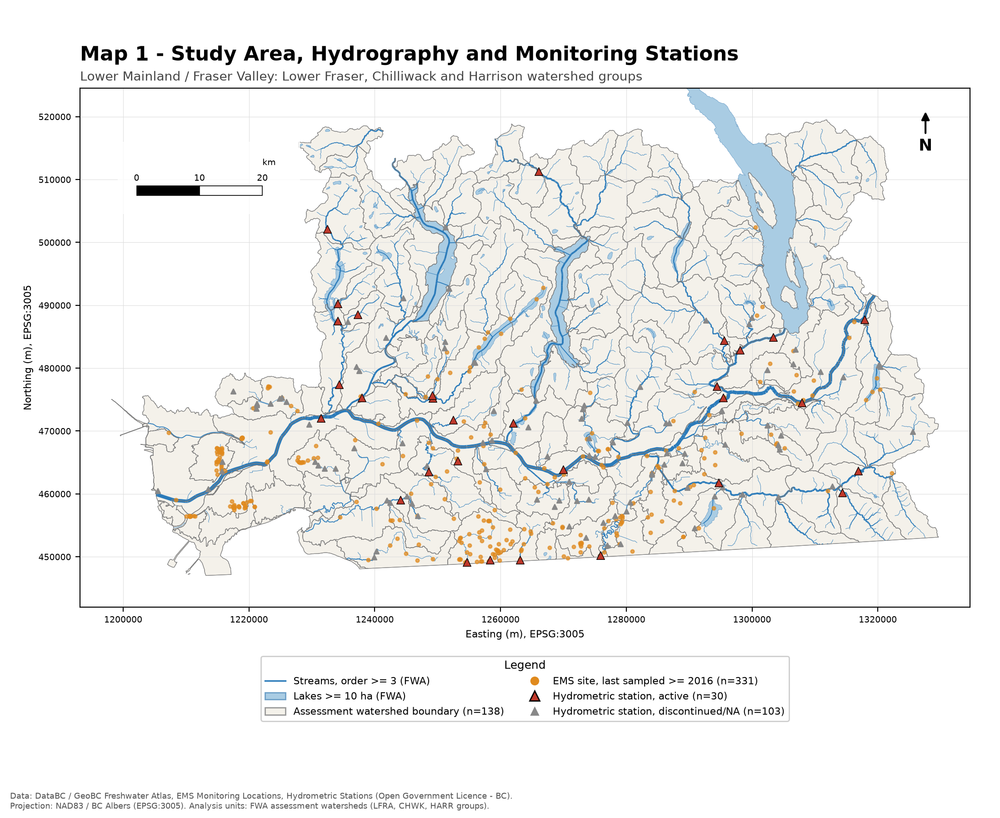
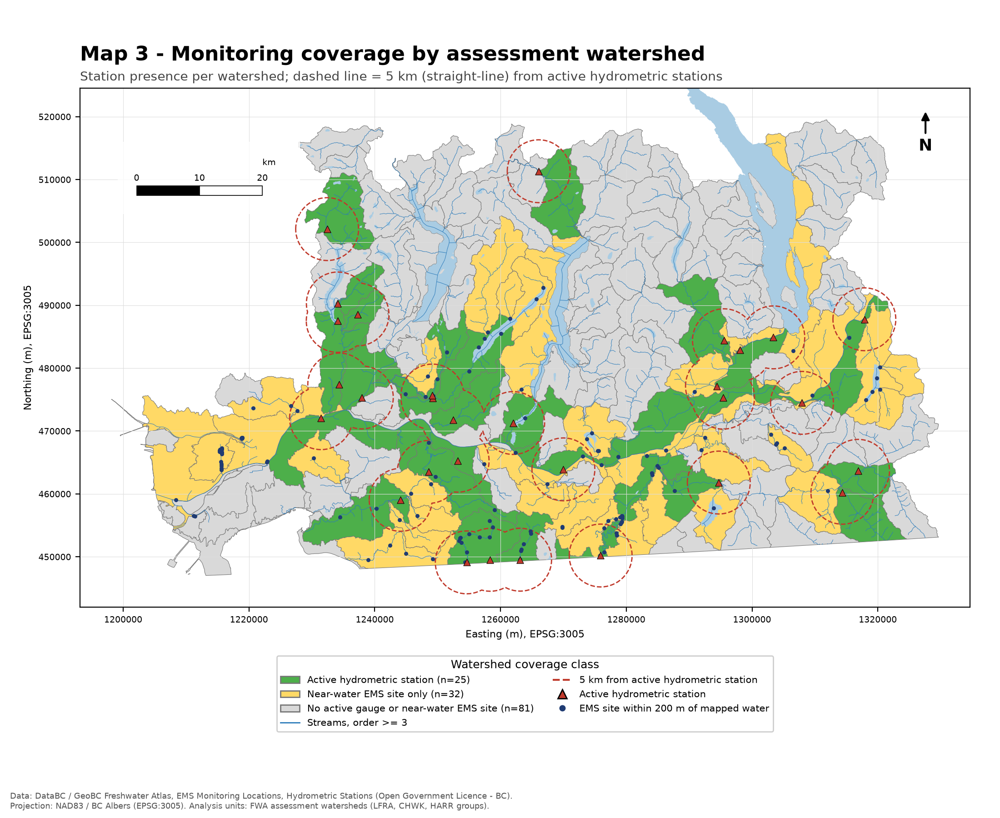

# BC Watershed GIS – Monitoring Network Coverage (Lower Mainland / Fraser Valley)

Where in the Lower Mainland and Fraser Valley are hydrometric gauges and water-sampling sites located, and which
watersheds have none? This project combines BC Freshwater Atlas hydrography with provincial monitoring-station
records, using GeoPandas/Shapely in NAD83 / BC Albers (EPSG:3005).

> Scope: this looks at where stations are, not what they measure. It uses no measurements, and station
> coverage says nothing about water quality, flow or environmental risk.

| | |
|---|---|
|  |  |

Maps: [1 – study area & stations](maps/01_study_area_stations.png) · [2 – site density](maps/02_station_density.png) · [3 – coverage & 5 km buffers](maps/03_coverage_buffers.png) · [4 – QGIS print layout](maps/04_qgis_coverage_layout.png)

## Data
Freshwater Atlas assessment watersheds, streams and lakes; hydrometric stations; and Environmental Monitoring System (EMS)
location records, all downloaded from the DataBC WFS under the Open Government Licence – British Columbia.
Details, layer names and filters: [docs/data_sources.md](docs/data_sources.md).

## Method
1. **Study area** – 138 FWA assessment watersheds (target size 20–100 km²) in the Lower Fraser, Chilliwack and Harrison
   watershed groups that lie fully inside the download extent (6,365 km²). 23 units of those groups that cross the
   extent were excluded rather than truncated.
2. **Stations**
   - *Active hydrometric*: status `ACTIVE` or `ACTIVE-REALTIME` (30 of 133 hydrometric stations in the study area; `NA` treated as inactive).
   - *Recent EMS*: fixed (non-mobile) EMS locations with at least one sample and a last sample on or after 2016-01-01.
     Records with no sample date are excluded. Records sharing identical coordinates are merged into one site
     (344 records → 331 sites).
   - *Near-water EMS (proxy)*: recent EMS sites within 200 m of a mapped stream (Strahler order ≥ 3) or lake (≥ 10 ha) – 129 sites.
     This is a spatial proxy, not a confirmed site type. EMS location-type codes were not decoded, so the recent EMS set
     includes all media (e.g. air, groundwater, permitted discharges). Being within 200 m of mapped water suggests, but does
     not confirm, a surface-water sampling site; sites on small (order 1–2) streams are missed.
3. **Spatial joins** – point-in-polygon counts per watershed (every station is assigned to exactly one unit).
   Density = sites per 100 km², using planar area in BC Albers (an equal-area projection). For the combined density,
   6 near-water EMS sites within 200 m of an active gauge are not counted as separate sites.
4. **Buffer / proximity** – 5 km straight-line buffers around stations are dissolved, then intersected with stream
   segments that are already split at watershed boundaries, so no stream length is counted twice. Stations up to the
   edge of the download extent (outside the study area) are included so that watersheds on the boundary are not penalised.
   Nearest-station distance is measured from each watershed's representative point.
5. **Coverage class** per watershed: *active hydrometric station* / *near-water EMS site only* / *no active gauge or near-water EMS site*.
6. **Validation** (`tests/`, `outputs/summary.json`) – all layers EPSG:3005; computed areas match the FWA `AREA_HA`
   attribute (max difference 0.0%); reprojecting EMS points to WGS84 reproduces the stored latitude/longitude
   (max error 0.38 m); point counts are conserved through the spatial join; watershed polygons do not overlap.

## Results
Figures from `outputs/summary.json` and `outputs/watershed_coverage.csv`.

| Coverage class | Watersheds | Share of area |
|---|---|---|
| Active hydrometric station | 25 | 24% |
| Near-water EMS site only | 32 | 27% |
| No active gauge or near-water EMS site | 81 | 49% |

- Of the 81 watersheds in the last class, 15 still contain recent EMS sites that did not meet the 200 m proxy. The class means
  "no gauge and no proxy-identified surface-water site", not "no monitoring of any kind".
- Overall density: 0.47 active hydrometric stations and 2.03 near-water EMS sites per 100 km² (2.40 distinct sites combined).
  The median watershed has zero, because sites are concentrated in a minority of units.
- Share of the 2,427 km of order ≥ 3 streams within 5 km (straight line) of a station:

  | Station set | % of stream length |
  |---|---|
  | Active hydrometric only | 31% |
  | Near-water EMS only | 45% |
  | Hydrometric or near-water EMS | 57% |
  | Hydrometric or any recent EMS | 63% |

  The near-water EMS figures are partly circular: those sites were selected *because* they are close to these same
  streams, so the 57% should be read as an upper-leaning estimate for that definition, not an independent measure.
- Sites cluster along the Fraser River corridor and the southern Fraser Valley. The mountainous Harrison and upper
  Chilliwack headwaters have few or no stations of either type.
- Sensitivity of the proxy: 85 / 104 / 129 / 179 / 213 recent EMS sites lie within 50 / 100 / 200 / 500 / 1000 m of mapped water.

## Interpretation and limitations
- Coverage is not risk or water quality. A watershed with no station is not shown to be degraded or at risk. Remote,
  undeveloped headwaters may reasonably have little monitoring, and a dense cluster says nothing about condition.
- The near-water EMS class is a proxy (see Method 2). It can include non-water sites that happen to be near a stream,
  and miss genuine sampling sites on small streams.
- EMS is a legacy snapshot. The province replaced EMS with EnMoDS in March 2026. "Recently sampled" (≥ 2016) is a
  threshold chosen for this project. Sampling frequency, parameters and data quality are not assessed.
- Density depends on unit size. One unit (Unnamed 8183, 0.08 km²) is a sliver, and its density is not meaningful.
- Edge effects. The study area follows the download extent, not a full watershed-group boundary. Stations beyond
  that extent are not available, so the outer edges may slightly under-report coverage.
- Networks not included: municipal, BC Hydro, industry and private networks, and the provincial groundwater observation-well network.
- 5 km is a screening distance. It is straight-line distance, so it ignores flow direction and drainage divides and does
  not mean a station represents that stream.

## QGIS project
`qgis/bc_watershed_coverage.qgz` loads the layers in `data/processed/analysis.gpkg` (EPSG:3005, relative paths), with
categorized watershed symbology and an A4 print layout ("Coverage map - A4 landscape") that produces
[map 4](maps/04_qgis_coverage_layout.png). Open the file in QGIS (built and checked with QGIS 4.2.3) and use
*Project > Layouts* to edit or re-export the map. `scripts/04_qgis_project.py` rebuilds the project from the GeoPackage with
PyQGIS; run it with the Python bundled with QGIS (see the script header). Maps 1–3 are produced with matplotlib.

## Reproduce
```bash
python3 -m venv .venv && source .venv/bin/activate
pip install -r requirements.txt
python scripts/01_download_data.py   # ~43 MB into data/raw (not committed)
python scripts/02_analysis.py        # -> data/processed/analysis.gpkg, outputs/*.csv, outputs/summary.json
python scripts/03_make_maps.py       # -> maps/01-03 (matplotlib)
pytest -q
# optional, needs QGIS installed: run scripts/04_qgis_project.py with QGIS's bundled Python
```
Tested with Python 3.13 on macOS. Data were retrieved on 2026-11-06 (see `docs/download_manifest.json`).
The WFS serves current data, so a later download may give slightly different counts.

## Licence
Code: MIT (see `LICENSE`). Data: contains information licensed under the
[Open Government Licence – British Columbia](https://www2.gov.bc.ca/gov/content?id=A519A56BC2BF44E4A008B33FCF527F61).
